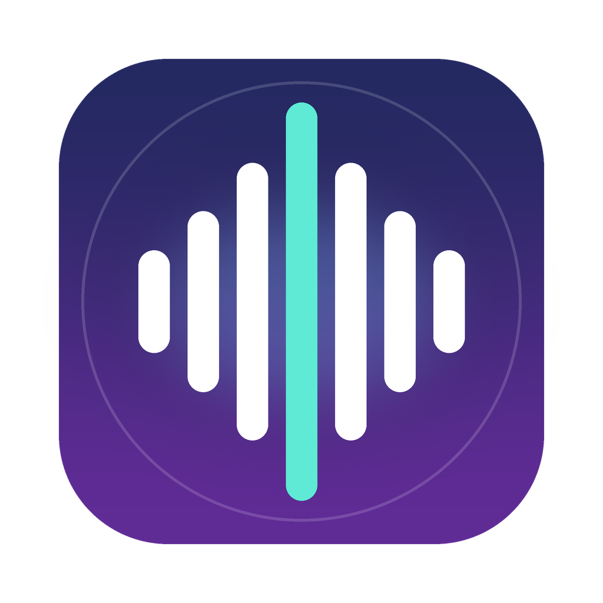

# Mac Sound Lab

Объёмный звук для macOS из того же DSP, что работает на ROG Ally и в Android-модуле
[DolbySoundMod](https://github.com/davnozdu/DolbySoundMod): виртуальные 7.1,
бинауральный рендер KU100, нейроразделение голоса StemgenRT и профиль для
подкастов и аудиокниг.



Перехватывает **весь системный звук** — YouTube, Plex, Steam, браузер, любой
плеер — и отдаёт обработанный на текущее устройство вывода. Без BlackHole,
без kext, без смены устройства вывода и без root.

## Что делает

| | Игра | Кино | Музыка | Подкаст |
|---|---|---|---|---|
| Голос над фоном (наушники, к «Игре») | 0 дБ | +1.7 дБ без нейросети; с ней голос выделяется на +15 дБ | 0 дБ | +3.2 дБ |
| Комната (RT60) | 0.22 с, тихая | 0.40 с | 0.25 с | 0.22 с, по тумблеру |
| Ширина | широкая | широкая | широкая | стерео источника, голос по центру |
| Нейросеть | нет (пассивная матрица) | StemgenRT | нет | нет, полка 2.8 кГц |
| Компрессия | нет (на динамиках/очках — да) | 3:1 от −14 dBFS | нет нигде | 3:1, выравнивание громкости |

- **Стерео → 3D.** Голос уводится в центр, остальное остаётся спереди, а
  разница каналов с задержкой 15 мс уходит в боковые и тыловые виртуальные
  динамики. Это 7 виртуальных динамиков (KU100, FL/FR ±30°, C 0°, SL/SR ±100°,
  RL/RR ±145°); канал LFE для стерео-источника создаётся только в «Кино» с
  нейросетью — бас и так идёт через фронты. На типичном стерео тылы и бока
  получают 8–11% энергии (разностный сигнал), голос по центру — 1–2%.
  Объём на ушах: межушная корреляция музыки падает с 0.91 до 0.75 (с комнатой
  0.62). Голос по центру без комнаты остаётся «в голове» (0.99), с комнатой
  — 0.82: вынос голоса из головы даёт именно комната. Уровень в наушниках
  откалиброван на единичное усиление: обработка не громче оригинала и не
  упирается в лимитер. Замеры — `tools/preset_check.cpp` и
  `tools/spatial_check.cpp`.
- **Нейросеть.** StemgenRT отделяет вокал от музыки и эффектов (замер на
  речи и вокале поверх музыки: в голосовом стеме голос/музыка +12…+20 дБ при
  −3 дБ на входе, у пассивной матрицы SDR голоса +1.5 дБ против +4.9…+8.8 дБ); в «Кино» её
  голос занимает центр с сохранением 25% в L/R, чтобы диалог не звучал
  навязчиво. Считается в отдельном потоке, при нехватке времени блок идёт без
  разделения — без треска и без провала.
- **Подкаст / YouTube / аудиокниги.** Голос поднимает статическая полка на
  2.8 кГц и выравниватель громкости; верх закрыт на 11 кГц — подкаст выше не
  несёт ничего, кроме шума кодека. Нейросеть в этом профиле не используется:
  её копия сигнала непрозрачна (ошибка −10 дБ от сигнала в среднем и наравне с
  сигналом в 4–8 кГц), на сжатом моно-голосе это слышно как хрип, а выигрыш —
  1.7 дБ присутствия, которые даёт та же полка. Стерео-картинка источника
  сохраняется, ширина не схлопывается в моно. Моно-запись (L=R) идёт в центр,
  но решение о моно сглажено на 250 мс: на реальном подкасте оно ходит около
  порога, и пошаговое переключение маршрута слышалось как хрип 83 раза в секунду.
  Реверберация подчиняется общему тумблеру.
- **Типы выхода.** Наушники — полный бинауральный HRTF. Динамики — режим
  ноутбучных динамиков: срез ниже 75 Гц, полка присутствия 2.2 кГц +4.5 дБ,
  side-канал приглушён (на двух динамиках в 20 см перекрёстная связь его всё
  равно убивает), виртуализатор выключен. Очки (XREAL/Viture/Rokid) — HRTF с
  подъёмом баса +2 дБ и полкой воздуха +2.5 дБ от 4 кГц (её забирает HRTF);
  в «Подкасте» полка воздуха не накладывается, чтобы не складываться с
  профильной.

## Как это работает

1. `CATapDescription` + `AudioHardwareCreateProcessTap` — системный стерео-микст
   (свой процесс исключён, исходный звук заглушается).
2. Приватное агрегатное устройство, внутри IOProc-блок читает звук блоками.
3. DSP-ядро (C++, то же `spatial.cpp`, что в Android-модуле) рендерит
   бинауральное стерео.
4. Кольцевой буфер с предзаполнением ~21 мс и плавной коррекцией дрейфа
   (линейная интерполяция, ±0.2%) отдаёт звук в HAL Output Unit выбранного
   устройства.

## Проверено

- DSP-ядро собирается clang'ом на arm64 без изменений и проходит свой тест.
  Числовая сверка с Python-эталоном плагина Decky (48 кГц, комната и нейросеть
  выключены): корреляция **0.999959**, остаток **−62 дБ**, задержка ровно один
  блок (2.65 мс).
- Офлайн-рендер: **50× реального времени** на одном ядре без нейросети,
  ~7× с нейросетью на CPU.
- Нейросеть на живом блоке: **0.30–0.45 мс** при бюджете 2.67 мс (в 6 раз
  быстрее, чем требовалось на Ally).
- Живой захват: tap 48 кГц / 2 канала, кольцо держит 21 мс, DSP 0.30 мс на блок.

## Установка

Нужен Mac на Apple Silicon, macOS 14.2+.

1. Скачай `MacSoundLab.zip` из [Releases](../../releases), распакуй, положи
   `Mac Sound Lab.app` в «Программы».
2. Первый запуск — правым кликом → **Открыть** (приложение подписано ad-hoc,
   не нотаризовано).
3. Система попросит разрешение **«Запись системного звука»** — разреши.
   Это единственное разрешение; доступ к экрану/микрофону не нужен.
4. Включи тумблер, выбери профиль и тип выхода.
5. Нейросеть работает сразу: модель StemgenRT (MIT) в int8 встроена в
   приложение (3 МБ), скачивать ничего не нужно.

## Процессор

- Нейросеть считается **одним потоком** без spinning: раньше ONNX Runtime держал
  два потока в busy-wait, и приложение жгло 129% CPU. Модель квантована в
  int8 (`tools/quantize_model.py`): 0.34 мс на блок вместо 0.47 при бюджете
  2.67 мс, качество разделения то же в пределах 0.1 дБ.
- **Тишина не считается.** Если tap отдаёт нули (ничего не играет), рендерер
  через 0.6 с уходит в шорткат и не гоняет ни сеть, ни свёртки: простой ~13%
  вместо ~36%. Хвост комнаты успевает догнить, обрезки нет, а на возврате
  звука фильтры сбрасываются, чтобы старый хвост не прилипал к новому блоку.
- Итого при воспроизведении ~37% одного ядра (модель 20% + DSP 10% + Core Audio).

## Обновления

Приложение само смотрит `https://api.github.com/repos/davnozdu/MacSoundLab/releases/latest`
(тихо при запуске и по кнопке «Проверить обновления»). Если версия новее:

- скачивает zip из релиза и распаковывает во временную папку;
- проверяет, что внутри именно `cz.davnozdu.macsoundlab` и та самая версия;
- запускает отдельный скрипт, который ждёт выхода приложения, подменяет бандл
  и открывает новую версию (`xattr -dr com.apple.quarantine` тоже делает он).

Тумблер «Обновляться автоматически» ставит обновление без вопросов при запуске.
Новые версии публикует GitHub Actions: пуш тега `vX.Y.Z` собирает arm64-сборку,
подписывает её (ad-hoc) и создаёт релиз с `MacSoundLab.zip`.

После обновления macOS один раз спросит разрешение на запись системного звука
заново — подпись ad-hoc новая. Это ограничение Apple, пока приложение не
подписано Developer ID.

## Сборка

```bash
./scripts/build.sh          # build/MacSoundLab.app (arm64, ad-hoc подпись)
open build/MacSoundLab.app
```

Скрипт сам скачивает ONNX Runtime 1.32.0 с NuGet, потому что релизы
`github.com/microsoft/onnxruntime` недоступны с 17 ноября 2026 (репозиторий
отдаёт 404, PyPI/NuGet живы). Заголовки кладутся в `core/third_party/include`,
`libonnxruntime.dylib` — в бандл.

Требуется только Xcode Command Line Tools. Иконка пересобирается
`tools/make_icon.py` (нужен Pillow), готовый `.icns` лежит в `assets/`.

Офлайн-рендер и проверки без разрешений:

```bash
swift build -c release --product soundlab-cli
.build/release/soundlab-cli in.wav out.wav --profile speech --device headphones \
    --model models/vocals.onnx --runtime core/third_party
```

## Ограничения

- **Задержка ~30 мс** (21 мс кольцо + блок tap + буфер вывода), в «Кино» с
  нейросетью ~60 мс: конвейер модели держит 11 блоков (29 мс) запаса. Меньше
  нельзя: при 4–6 блоках модель пропускает до 29 блоков за 12 с. Для кино,
  музыки и подкастов незаметно; для шутеров на уровне «нормально», но не 3 мс
  как на PipeWire.
- **Только стерео-источник.** Core Audio tap отдаёт стерео-микст; настоящие
  5.1/7.1 приложение получает лишь в офлайн-рендере. На практике системный
  звук на Mac и так стерео.
- **Подпись — свой сертификат, не Developer ID.** С 0.5.0 сборки подписаны
  постоянным самоподписанным сертификатом «Mac Sound Lab Signing», поэтому
  разрешение «Запись системного звука» сохраняется между обновлениями (один раз
  его придётся выдать при переходе с 0.4.x), а автообновление ставит только
  сборки с этим же сертификатом. Нотаризации нет: первый запуск — правым
  кликом → «Открыть». Сертификат лежит локально в
  `~/.config/macsoundlab-signing` и для CI — в секретах репозитория
  (`SIGN_P12_BASE64`, `SIGN_P12_PASSWORD`); без него `build.sh` подписывает
  ad-hoc, а релиз из CI не соберётся.
- **Нейросеть — CPU, Neural Engine не используется намеренно.** В старом
  формате CoreML модель не компилируется (`generic_general_slice`), в формате
  MLProgram компилируется, но граф режется на 15 кусков, и выходит хуже CPU по
  всем показателям: 1.08 мс против 0.48 мс на блок и 1.21 мс против 0.47 мс
  процессорного времени. Модель грузится в фоне только для «Кино» с
  включённой нейросетью. Стоимость — 0.34 мс CPU на блок 2.67 мс (int8); в процентах вживую
  это 25–60% одного ядра в зависимости от того, на P- или E-ядро macOS
  поставит поток (на E-ядре процентов больше, энергии меньше).
- Коррекция встроенных динамиков из CachyOS (`game.wav`) к Mac не применима:
  для `MacBook`-динамиков FIR-а нет, профиль «Динамики» работает без коррекции.

## Структура

```
core/            C++ DSP из Android-модуля (spatial, vocals, FFT, HRIR KU100)
  include/       плоская C-шапка для Swift
Sources/MacSoundLab/   приложение: tap, кольцо, HAL-output, SwiftUI
Sources/SoundLabCLI/   офлайн-рендер и проверки
tools/           генерация HRIR, иконки, сверка с Python-эталоном
scripts/         build.sh, Info.plist, entitlements
```

## Лицензии и кредиты

- HRTF: SADIE II / SADIE Database, KU100 DFC, 48 кГц (Zenodo 12542676, Apache 2.0).
- Нейросеть: [StemgenRT](https://github.com/sweetspotsoundsystem/stemgen-rt) (MIT),
  в приложение встроена int8-версия модели vocals (`assets/models`, лицензия
  рядом); исходная fp32-модель в репозиторий не входит.
- Виртуализатор динамиков и динамика — по мотивам
  [x20-speaker-dsp](https://github.com/ismailkose/x20-speaker-dsp) (MIT).
- ONNX Runtime — MIT, Microsoft.
- Код приложения — MIT.
